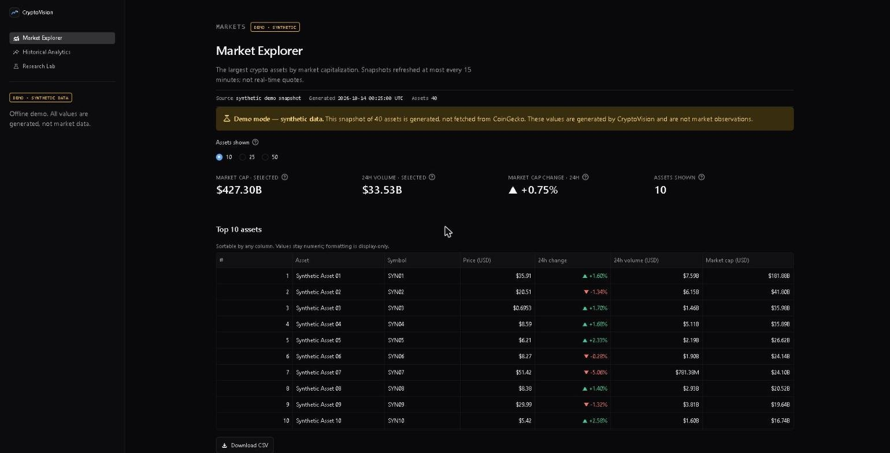
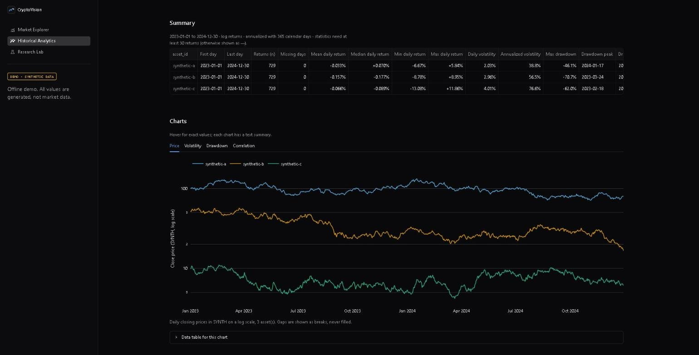
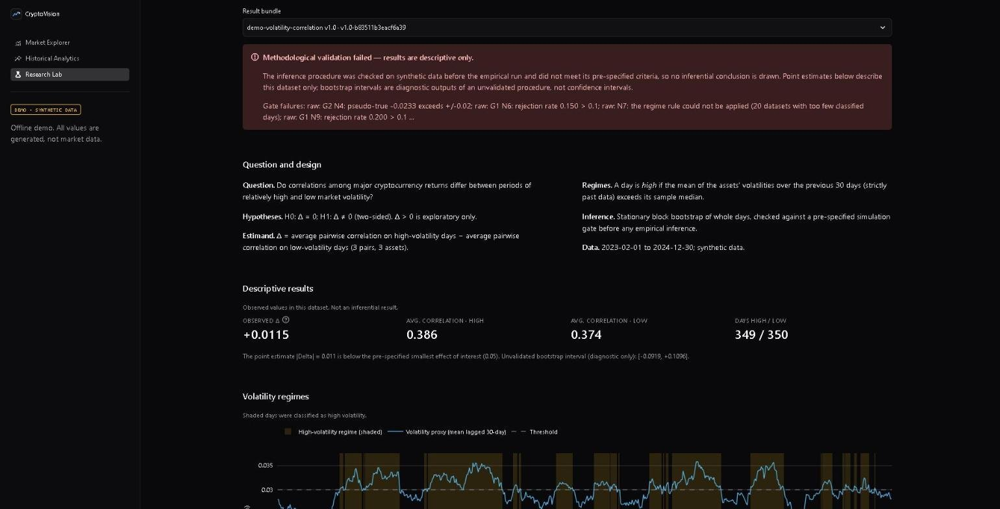
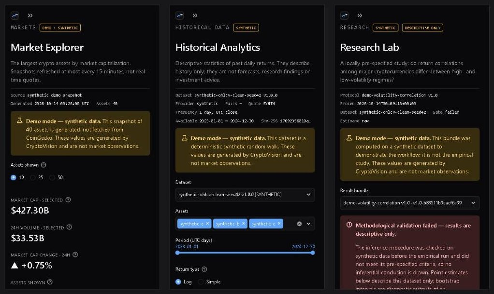

# CryptoVision

**A reproducible cryptocurrency market analytics and research platform.**

CryptoVision is a Python and Streamlit application for exploring cryptocurrency market data. It combines a live market view, a hash-verified historical data pipeline, descriptive analytics and a reproducible research workflow for studying volatility and correlation among major cryptocurrencies.

> CryptoVision is an educational and academic research project. It is not a trading platform and does not provide investment advice.



## Status

**Version 1.0.0rc1 — release candidate.** It runs locally only; nothing is deployed or published. Open items are listed in the [release notes](docs/release-notes-1.0.0rc1.md).

| Module | Status |
|---|---|
| Market Explorer | Available (live CoinGecko data, or synthetic in demo mode) |
| Historical data pipeline | Available (command line) |
| Historical Analytics | Available (descriptive, offline) |
| Research Lab | Available (one pre-specified study) |
| Offline demo | Available (`cryptovision-demo`) |

### Research result in one sentence

The pre-specified study of whether return correlations differ between high- and low-volatility regimes **did not pass its own methodological validation gate**, so its results are **descriptive only** and support no inferential conclusion. The study is not peer reviewed and was not externally registered. Its results are generated locally from the git-ignored dataset and are not distributed with the repository.

## Quick start: offline demo

No API key and no market data needed. Install (see [Installation](#installation-windows-powershell)), then run:

```powershell
cryptovision-demo
```

The first run builds synthetic data under `.demo/` (about 25 seconds) and opens the app at http://localhost:8501. Every page is labelled **Demo mode — synthetic data**; the values are generated by CryptoVision and are not market observations. More in [Getting started](docs/getting-started.md).

## Screenshots

All screenshots were taken in demo mode and show synthetic data only.

| Historical Analytics | Research Lab |
|---|---|
|  |  |



## Features

- **Market Explorer**: the top 10, 25 or 50 assets by market capitalization, with price, 24h change, 24h volume and market cap.
- **Correctly scoped metrics**: totals are labelled as aggregates over the *selected assets only*, not the whole crypto market.
- **Numeric tables**: values stay numeric and sort by value. Formatting is applied only for display, and very small prices keep their significant digits.
- **Data freshness**: the provider's last-update time and the fetch time are shown in UTC, together with whether the data came from the cache.
- **CSV export**: an in-memory download of raw values at full precision, with currency, source and fetch-time columns.
- **Interactive charts**: market cap (linear or log scale) and 24h price change, built with Plotly.
- **Historical data pipeline** (`cryptovision-data` CLI):
  - Builds reproducible daily datasets from Binance Vision archives, each verified against its SHA-256 checksum.
  - Validates every dataset with explicit fatal/error/warning issues.
  - Stores Parquet files with a provenance manifest (sources, hashes, configuration, validation report).
  - Supports offline rebuilds and integrity verification.
- **Historical Analytics** (`cryptovision.analytics` and a dashboard page):
  - Simple and log returns.
  - Daily and annualized volatility (365-day convention), with rolling windows of 7, 30 and 90 days.
  - Maximum drawdown with peak, trough and recovery dates.
  - Pearson and Spearman correlation matrices with sample counts, and rolling correlation.
  - Calendar-aware gap handling: no interpolation and no forward-filling.
  - Works offline on validated local datasets only.
- **Research Lab** (`cryptovision-research` CLI and a dashboard page):
  - A frozen, hash-locked protocol and configuration.
  - A strictly past volatility-regime classification.
  - A stationary block bootstrap that resamples whole days jointly across assets.
  - Synthetic validation with a pre-specified gate before any empirical inference.
  - A pre-specified robustness grid.
  - Immutable, hash-verified result bundles and a generated academic report.
- **Offline demo** (`cryptovision-demo`): all three pages on clearly labelled synthetic data, without an API key or network access.
- **Design system**: tested WCAG AA text contrast, colorblind-safe chart palettes, text summaries and data tables for every chart, keyboard focus ring. See [design system](docs/design-system.md).
- **API budget protection**:
  - Data is cached for 15 minutes by default.
  - Manual refresh is limited to once per 60 seconds.
  - After a failure, the app waits before contacting the provider again.
  - Changing the asset count never makes a request.

## Requirements

- Python **3.12** (primary) or **3.13**
- Windows, Linux or macOS
- A free [CoinGecko Demo API key](https://www.coingecko.com/en/api) for live data. Tests do not need one.

## Installation (Windows PowerShell)

```powershell
git clone https://github.com/CaioVenxncio/cryptovision-dashboard.git
cd cryptovision-dashboard

python -m venv .venv
.\.venv\Scripts\Activate.ps1

python -m pip install --upgrade pip
pip install -r requirements-dev.txt
pip install -e . --no-deps
```

Troubleshooting:

- **Script blocked:** if PowerShell blocks the activation script, run `Set-ExecutionPolicy -Scope CurrentUser RemoteSigned` once.
- **`WinError 206`** ("file name or extension is too long"): Streamlit contains deeply nested files. Clone into a short path such as `C:\dev\cryptovision`, or enable Windows long-path support.
- **Linux or macOS:** activate the environment with `source .venv/bin/activate`.

## Configuration

1. Copy the example file:
   ```powershell
   Copy-Item .env.example .env
   ```
2. Edit `.env` and set `COINGECKO_API_KEY`.

`.env` is excluded by `.gitignore` and must never be committed.

| Variable | Default | Description |
|---|---|---|
| `COINGECKO_API_KEY` | none | CoinGecko Demo API key. Required for live data. |
| `CACHE_TTL_SECONDS` | `900` | How long fetched data is reused (60–86400). |
| `HTTP_TIMEOUT_SECONDS` | `10` | Per-request timeout (up to 60). |
| `HTTP_MAX_RETRIES` | `3` | Retries after timeouts, HTTP 429 or HTTP 5xx (0–5). |
| `CRYPTOVISION_DATA_DIR` | `data` | Directory of local datasets. |
| `CRYPTOVISION_RESULTS_DIR` | `research/results` | Directory of research result bundles. |
| `CRYPTOVISION_DEMO` | off | `1` turns on demo mode (set automatically by `cryptovision-demo`). |

The key is sent only in the `x-cg-demo-api-key` request header, never in URLs, logs or error messages.

## Running the application

```powershell
streamlit run app.py
```

Then open http://localhost:8501. Use the sidebar to switch between **Market Explorer** (live CoinGecko data), **Historical Analytics** (local datasets, offline) and **Research Lab** (pre-computed result bundles, offline). The analytics page lists only research-ready, unexpired datasets from `data/` (override with `CRYPTOVISION_DATA_DIR`).

## Historical datasets

Datasets are defined by TOML files in `configs/datasets/` and stored under the git-ignored `data/` directory.

| Config | Provider | Retention |
|---|---|---|
| `binance-spot-1d-top10-20210103.toml` | Binance Vision, 9 USDT spot pairs, 2021–2025 | Archival research dataset |
| `coingecko-daily-365d.toml` | CoinGecko, last 365 days | **Disabled**: storing CoinGecko history is turned off pending an encryption design (CoinGecko terms §6.1.2) |

```powershell
$cfg = "configs\datasets\binance-spot-1d-top10-20210103.toml"
$ds  = "data\datasets\binance-spot-1d-top10-20210103\1.0.0"

cryptovision-data plan $cfg                      # offline: assets, period, request count
cryptovision-data collect $cfg                   # dry run, no requests
cryptovision-data collect $cfg --yes             # download, verify and build
cryptovision-data list
cryptovision-data show $ds --issues
cryptovision-data verify $ds --sources           # recompute every hash
cryptovision-data validate $ds
cryptovision-data collect $cfg --offline --force # rebuild from local archives only
cryptovision-data synthetic --days 90 --seed 42 --anomalies
cryptovision-data purge-expired                  # delete expired CoinGecko caches
```

- **Network access:** only `collect --yes` uses the network. Every other command, `collect --offline` and the test suite work offline.
- **Without the installed script:** run `python -m cryptovision.data` instead of `cryptovision-data`.
- **Data rights:** never commit or share files from `data/`; provider terms restrict redistribution.

Further reading:

- [Data sources and licensing](docs/data-sources.md)
- [Data methodology](docs/data-methodology.md)
- [Analytics methodology](docs/analytics-methodology.md)
- [Research methodology](docs/research-methodology.md), [research reproducibility](docs/research-reproducibility.md), [research limitations](docs/research-limitations.md)
- [Reproducibility](docs/reproducibility.md)
- [Limitations](docs/limitations.md)

## Research Lab

The study asks: *do correlations among major cryptocurrency returns differ between periods of relatively high and low market volatility?*

- **Protocol:** written and frozen before any regime-conditional statistic was computed: [protocol](research/protocols/volatility-correlation-v1.md), [configuration](configs/experiments/volatility-correlation-v1.toml) and hash [lock](research/protocols/volatility-correlation-v1.lock.json).
- **Workflow** (offline, after the dataset has been built):

```powershell
$exp = "configs\experiments\volatility-correlation-v1.toml"
cryptovision-research validate $exp     # protocol unchanged since freezing?
cryptovision-research plan $exp
cryptovision-research simulate $exp     # synthetic method validation and gate (~30 min)
cryptovision-research run $exp          # primary analysis, robustness, report
cryptovision-research list
cryptovision-research verify research\results\volatility-correlation\<bundle>
```

- **Results:** written to `research/results/`, which is git-ignored because the results are derived from provider data. Each bundle contains `results.json`, `regimes.csv`, `robustness.csv`, `report.md`, snapshots of the config and lock, and a hash manifest. The Research Lab page shows them.
- **Further reading:** [research methodology](docs/research-methodology.md), [reproducibility](docs/research-reproducibility.md), [limitations](docs/research-limitations.md).

## Development

### Tests and coverage

The tests need no API key and make no network requests; all HTTP calls are mocked.

```powershell
pytest                                     # run the test suite
pytest --cov                               # terminal coverage summary (minimum 90%)
pytest --cov --cov-report=html             # HTML report in htmlcov\index.html
pytest --cov --cov-report=xml              # coverage.xml, as produced in CI
```

### Linting and formatting

```powershell
ruff check .            # lint
ruff format .           # format
ruff format --check .   # verify formatting without changing files
```

### Pre-commit hooks and secret scanning

[pre-commit](https://pre-commit.com) runs these checks before every commit:

- [Gitleaks](https://github.com/gitleaks/gitleaks) scans staged changes for credentials.
- Ruff lints and checks formatting.
- [actionlint](https://github.com/rhysd/actionlint) validates the workflow files.
- Standard hooks detect private keys and large files.

```powershell
pre-commit install            # one-time: enable the hooks for this clone
pre-commit run --all-files    # run every hook manually
```

The first run downloads and builds the hook tools, which takes a few minutes.

If Gitleaks blocks a commit, do not bypass it. Remove the secret from the staged files and rotate the credential if it was real.

To scan the full Git history with the Gitleaks binary that pre-commit installed:

```powershell
$gitleaks = Get-ChildItem "$HOME\.cache\pre-commit" -Recurse -Filter gitleaks.exe | Select-Object -First 1
& $gitleaks.FullName git --redact .
```

This history scan reports one known finding: an old CoinMarketCap API key in commit `ca9f2df` (`api.py`). The code no longer uses it. **The key has been revoked by the repository owner and is invalid**, but it remains visible in the public history, which is intentionally not rewritten. See [security](docs/security.md).

### Dependencies

Dependency ranges live in `pyproject.toml`. Exact pins are generated with [pip-tools](https://pip-tools.readthedocs.io); shared options are set in the `[tool.pip-tools]` section.

```powershell
pip-compile -o requirements.txt requirements.in   # runtime lock, includes the project itself (-e .)
pip-compile --extra dev -o requirements-dev.txt pyproject.toml
pip-sync requirements-dev.txt
pip install -e . --no-deps
```

Lock files are generated on Windows with Python 3.13. CI checks that they match `pyproject.toml`. `requirements.txt` installs the project itself in editable mode, so `pip install -r requirements.txt` alone is enough to run the app (this is what Streamlit Community Cloud does).

### Continuous integration

`.github/workflows/ci.yml` runs on pushes to `main`, on pull requests and on manual dispatch.

- **Matrix**: Ubuntu and Windows × Python 3.12 and 3.13.
- **Each job**:
  - installs the pinned dependencies
  - runs `pip check`, Ruff lint and Ruff format checks
  - runs pytest with coverage
  - uploads `coverage.xml`
- **Dependency-audit job**: runs `pip-audit` on the pinned dependencies.
- **Lock-file job**: confirms the lock files are up to date.

The workflow uses a read-only token, needs no secrets, and pins every action to a commit SHA. It has not yet run on GitHub for this release candidate, so no CI status badge is shown.

## Architecture

```
cryptovision-dashboard/
├── app.py                        # Streamlit entry point and page navigation
├── views/                        # Market Explorer, Historical Analytics and Research Lab pages
├── assets/                       # Logo and mark (SVG)
├── .streamlit/config.toml        # Streamlit theme matching the design tokens
├── src/cryptovision/
│   ├── config.py                 # Validated settings from the environment
│   ├── models.py                 # Pydantic models with provenance
│   ├── market.py                 # Numeric DataFrames, aggregates, CSV export
│   ├── formatting.py             # Display-only formatting
│   ├── providers/                # HTTP client, CoinGecko client, errors
│   ├── data/                     # Historical datasets: config, sources, validation, storage, CLI
│   ├── analytics/                # Returns, volatility, drawdown, correlation (Streamlit-free)
│   ├── research/                 # Protocol lock, regimes, estimands, bootstrap, simulation, artifacts, CLI
│   ├── demo.py                   # Offline demo (cryptovision-demo)
│   └── ui/                       # Design system, data loading/cache, components, charts, pages
├── configs/datasets/             # Dataset definitions (TOML)
├── configs/experiments/          # Frozen experiment configurations (TOML)
├── research/protocols/           # Frozen research protocols and their hash locks
├── data/                         # Local datasets (git-ignored)
├── tests/                        # Offline test suite
├── docs/                         # Guides, methodology, architecture, design system, security (see docs/index.md)
└── .github/workflows/ci.yml      # Continuous integration
```

See [docs/architecture.md](docs/architecture.md) for the data flow, caching, error handling, testing and security design.

## Data provider and limitations

Live market data is powered by [CoinGecko](https://www.coingecko.com/en/api) through the Demo API. Historical research datasets come from [Binance Vision](https://data.binance.vision) under CC BY-NC-SA 4.0 (see [data sources](docs/data-sources.md)).

- **Not real-time.** CoinGecko refreshes Demo data about every 60 seconds, and CryptoVision reuses fetched data for up to `CACHE_TTL_SECONDS`.
- **Request budget.** The Demo plan has a monthly call limit (10,000 calls at the time of writing). Each cache refresh uses one call.
- **Historical depth.** The Demo plan provides roughly one year of history, and CoinGecko's terms restrict storing it (refresh within 24 hours, strong encryption). CryptoVision therefore does not store CoinGecko history; research uses Binance Vision, whose prices are exchange-specific and quoted in USDT, not USD.
- **Scope.** Only USD and the top 100 assets by market cap are fetched. Totals cover the selected assets only.
- **Cache scope.** The cache is held in memory per server process and is lost on restart.
- **Attribution.** CoinGecko requires attribution, which the app displays.

Check [CoinGecko's pricing page](https://www.coingecko.com/en/api/pricing) for current plan terms.

## Roadmap

1. Secure CoinGecko migration (complete)
2. Engineering foundation: CI, coverage, UI modularization, secret scanning (complete)
3. Historical data pipeline with provenance records (complete)
4. Quantitative analytics: returns, volatility, drawdown, correlation (complete)
5. Research Lab: reproducible volatility and correlation experiments (complete)
6. Design system, offline demo mode and release readiness (release candidate 1.0.0rc1)

Possible future work, not started: a new, separately pre-registered protocol with a method that passes validation (v1 stays unchanged), and a reviewed deployment (see [deployment](docs/deployment.md)).

## License and citation

- **Code:** released under the [MIT License](LICENSE).
- **Binance Vision data and anything derived from it** (local datasets, research results and reports) are **not** covered by the MIT License. They are subject to the Binance Vision terms and [CC BY-NC-SA 4.0](https://creativecommons.org/licenses/by-nc-sa/4.0/): attribution required, non-commercial use only, share-alike, and no hosting of the datasets. That is why none of them are in the repository. See [data sources](docs/data-sources.md).
- **CoinGecko data** is subject to the CoinGecko API terms and is not stored.
- **Logo and screenshots** in `assets/` and `docs/images/` are part of this project and show synthetic data only.
- CryptoVision makes no legal-compliance claim; these notes summarize the terms as read on 2026-10-13.
- **Citation:** see [CITATION.cff](CITATION.cff).
- **Security:** see [docs/security.md](docs/security.md), including the revoked historical credential that remains visible in Git history.

## Author

**Caio Venancio**

- LinkedIn: [Caio Venancio](https://www.linkedin.com/in/caio-venancio/)
- GitHub: [@CaioVenxncio](https://github.com/CaioVenxncio)
- Email: caiovenanciocommercial@gmail.com
