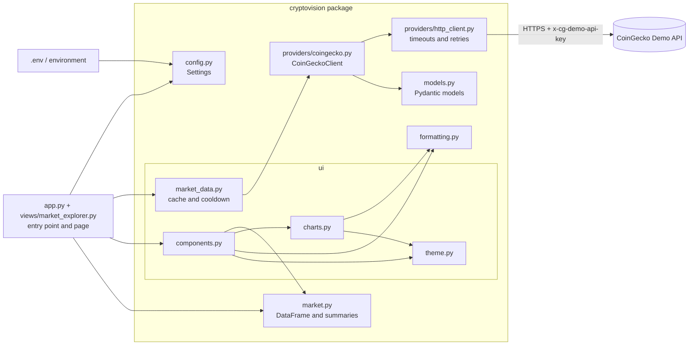

# CryptoVision Architecture

This document describes the architecture as currently implemented. Planned work is listed separately in [Planned evolution](#14-planned-evolution) and is not yet part of the code.

## 1. Purpose

CryptoVision is an educational and research-oriented cryptocurrency market analytics application. The current release provides:

- a **Market Explorer** backed by the CoinGecko Demo API;
- a **historical data pipeline** that builds validated, hash-verified Parquet datasets with provenance manifests;
- a **quantitative analytics engine** (returns, volatility, drawdown, correlation) and a Historical Analytics page that works offline on validated datasets.

A later phase will add a reproducible Research Lab.

The project deliberately stays a single Python package with a Streamlit front end. There is no separate backend service, database or frontend framework.

## 2. High-level architecture

Dependencies point one way: `app.py` → `views` → `ui` → domain modules (`market`, `formatting`, `models`) → `providers` → `config`. Domain and provider modules never import Streamlit, so they can be reused by future notebooks and pipelines.

## 3. Modules and responsibilities

| Module | Responsibility |
|---|---|
| `app.py` | Streamlit entry point: page configuration and `st.navigation` between the two pages. |
| `views/market_explorer.py` | Market Explorer page: loads settings, calls the data loader and lays out components. |
| `views/historical_analytics.py` | Historical Analytics page; delegates to `ui/analytics_view.py`. |
| `cryptovision/config.py` | Reads environment variables (and `.env` via python-dotenv) into a validated, immutable `Settings` model. |
| `cryptovision/providers/http_client.py` | Generic JSON-over-HTTP client: timeouts, bounded exponential backoff, `Retry-After` handling, error classification. |
| `cryptovision/providers/coingecko.py` | CoinGecko-specific requests (`/coins/markets`, `/simple/price`), authentication header and response validation. |
| `cryptovision/providers/errors.py` | Exception hierarchy with display-safe messages. |
| `cryptovision/models.py` | Pydantic models for validated provider data, including provenance (`provider`, `endpoint`, `fetched_at`). |
| `cryptovision/market.py` | Converts snapshots to numeric DataFrames, computes selected-asset aggregates, builds CSV exports. |
| `cryptovision/formatting.py` | Display-only formatting of currency, percentages and UTC timestamps. |
| `cryptovision/ui/market_data.py` | Streamlit caching, cache expiry and the per-session failure cooldown. |
| `cryptovision/ui/components.py` | Reusable Streamlit components: sidebar, metrics, table, export, error states and footer. |
| `cryptovision/ui/charts.py` | Pure Plotly figure builders. |
| `cryptovision/ui/theme.py` | Colors and shared visual constants. |
| `cryptovision/data/config.py` | Dataset TOML configuration, validated with Pydantic. |
| `cryptovision/data/schemas.py` | Arrow schemas for the `ohlcv` and `price_series` dataset kinds. |
| `cryptovision/data/sources/` | Binance Vision archive download, checksum verification and parsing; CoinGecko chart normalization. |
| `cryptovision/data/validate.py` | Integrity checks with fatal/error/warning issues and rejected-row tracking. |
| `cryptovision/data/storage.py` | Atomic writes, Parquet I/O, canonical content hashing. |
| `cryptovision/data/provenance.py` | Dataset manifest model. |
| `cryptovision/data/pipeline.py` | Planning, collection, atomic dataset assembly, verification, loading, cache expiry. |
| `cryptovision/data/synthetic.py` | Deterministic synthetic OHLCV data with optional injected defects. |
| `cryptovision/data/cli.py` | `cryptovision-data` command-line interface. |
| `cryptovision/analytics/alignment.py` | Validates observations and builds a calendar-complete daily price panel (no filling). |
| `cryptovision/analytics/returns.py` | Simple and log returns with a per-cell status (valid, first observation, missing price, after gap). |
| `cryptovision/analytics/volatility.py` | Sample volatility, annualization, rolling volatility. |
| `cryptovision/analytics/drawdown.py` | Drawdown series and maximum drawdown with peak, trough and recovery. |
| `cryptovision/analytics/correlation.py` | Pearson and Spearman matrices (pairwise deletion, counts) and rolling correlation. |
| `cryptovision/analytics/descriptive.py` | Per-asset descriptive summary. |
| `cryptovision/analytics/data.py` | The only loader for real data; goes through the Phase 3 integrity checks. |
| `cryptovision/analytics/models.py` | Enums, analysis context and reproducibility metadata. |
| `cryptovision/ui/analytics_view.py`, `ui/analytics_charts.py` | Analytics page components and Plotly figure builders. |

## 4. Data flow

1. The Market Explorer page (`views/market_explorer.py`) calls `load_settings()`. An invalid value stops the app with a message naming the variable, never its value.
2. `load_market_snapshot()` returns the cached snapshot, or calls `CoinGeckoClient.get_markets()` once if the cache is empty or expired.
3. The client sends `GET /coins/markets?vs_currency=usd&order=market_cap_desc&per_page=100&page=1&sparkline=false`. One request covers every slider position (5–50 assets).
4. Each record is validated into a `MarketCoin`. Invalid records are dropped and counted. The batch becomes a `MarketSnapshot` with `fetched_at` in UTC.
5. `snapshot_to_frame()` produces a DataFrame with float64 numeric columns, nullable `Int64` rank and UTC timestamps, sorted by rank.
6. `select_top()` takes the first N rows. `summarize_selection()` computes the selected-asset totals.
7. Components render metrics, the table and charts. Values are formatted only at this point.
8. The CSV export serializes the raw numeric values in memory, with `currency`, `source` and `fetched_at` columns.

## 5. Authentication and configuration

| Variable | Default | Validation |
|---|---|---|
| `COINGECKO_API_KEY` | none | Blank counts as missing. Stored as `SecretStr`. |
| `COINGECKO_BASE_URL` | `https://api.coingecko.com/api/v3` | Must use `https://`. |
| `CACHE_TTL_SECONDS` | `900` | 60–86400 |
| `HTTP_TIMEOUT_SECONDS` | `10` | greater than 0, up to 60 |
| `HTTP_MAX_RETRIES` | `3` | 0–5 |

- `.env` is loaded with `override=False`, so real environment variables take precedence.
- The key is sent only in the `x-cg-demo-api-key` header. It never appears in URLs, cache keys, `repr()` output, logs or error messages.
- A missing key is detected before any request is made, and the app shows setup instructions instead.

## 6. HTTP retries, rate limits and errors

| Condition | Behavior | Exception |
|---|---|---|
| HTTP 2xx with invalid JSON | No retry | `ResponseSchemaError` |
| HTTP 401 / 403 | No retry | `AuthenticationError` |
| HTTP 429 | Retry; waits `Retry-After` if given, else backoff | `RateLimitError` |
| HTTP 429 with `Retry-After` above 60 s | Fails immediately instead of blocking | `RateLimitError` |
| HTTP 500 / 502 / 503 / 504 | Retry with backoff | `ProviderUnavailableError` |
| Timeout / connection error | Retry with backoff | `ProviderUnavailableError` |
| Other HTTP 4xx | No retry | `ProviderRequestError` |
| Other `requests` errors | No retry | `ProviderUnavailableError` |

Backoff for attempt *n* (0-based) is `min(30, 1 × 2^n)` seconds multiplied by a random jitter factor between 0.5 and 1.0. The number of retries is capped by `HTTP_MAX_RETRIES`, so the worst case is a bounded number of requests per load.

## 7. Caching strategy

Streamlit reruns the page script on every interaction, so caching is essential to protect the Demo plan's monthly request budget.

- `_fetch_market_snapshot` is wrapped in `st.cache_data`, a process-wide in-memory cache. The settings argument is excluded from the cache key.
- `load_market_snapshot` treats a cached snapshot older than `CACHE_TTL_SECONDS` as expired, clears it and fetches once.
- **Manual refresh** is enabled only when data is at least 60 seconds old, which matches CoinGecko's update interval for Demo data.
- **Failure cooldown**: failures are not cached. A failure is recorded in the session state and blocks new requests for 60 seconds, or longer if the server's `Retry-After` asks for it. Without this, every rerun would hit a failing API.
- The page states whether data was retrieved just now or comes from the cache, and shows both the provider update time and the fetch time in UTC.

## 8. Validation

Pydantic v2 validates:

- **Configuration**: types, ranges, the HTTPS-only base URL and the masked secret.
- **Provider records**: `id`, `symbol` and `name` are required. Market values may be null and become `None`, then NaN in DataFrames. Unknown fields are ignored. Timestamps are normalized to UTC, and naive values are treated as UTC.

A response whose top-level shape is wrong, or where every record is invalid, raises `ResponseSchemaError`.

## 9. Transformation and formatting

- Numeric columns stay numeric through analysis and export, so table sorting is by value.
- **Selected-asset aggregates**: the market cap and volume sums cover the selected rows only. The 24h change is `sum(market_cap_change_24h) / sum(market_cap − market_cap_change_24h) × 100`, the change of the combined market cap.
- **Display formatting**:
  - Values of $1 or more use two decimals.
  - Values below $1 keep four significant digits.
  - Compact mode uses K/M/B/T suffixes.
  - Negative values are written `-$x`.
  - Missing values are shown as `—`.

## 10. Testing strategy

All tests run offline. The `responses` library intercepts every `requests` call, and an autouse fixture sets `COINGECKO_API_KEY=""` so the developer's real `.env` key is never loaded during tests.

| Test module | Focus |
|---|---|
| `test_config.py` | Parsing, validation errors without echoed values, `.env` precedence |
| `test_http_client.py` | Backoff arithmetic, `Retry-After` parsing |
| `test_coingecko.py` | Header authentication, URL never containing the key, 401/403/429/5xx, retries, timeouts, malformed and partial responses |
| `test_market.py` | Numeric dtypes, ordering, aggregates, CSV round-trip |
| `test_formatting.py` | Currency, percentage and timestamp edge cases |
| `test_market_data.py` | Cache reuse, expiry, cooldown and recovery |
| `test_charts.py`, `test_components.py` | Figure contents and table display formatting |
| `test_app.py` | The real app (navigation plus Market Explorer page) via Streamlit's `AppTest`: rendering, request counts across reruns, refresh, errors and recovery |
| `test_analytics_*.py` | Hand-calculated returns, volatility, drawdown and correlation; alignment and gap policy; references against `statistics` and SciPy; independent checks on the real dataset (skipped when absent); Analytics page via `AppTest` |
| `test_data_*.py` | Dataset configs, Binance archive parsing and checksum handling, CoinGecko chart parsing, validation rules and thresholds, Parquet round trips, hashing, atomic writes, interrupted runs, offline rebuilds, cache expiry, CLI commands |

Coverage is measured with branch coverage over `cryptovision`, `app.py` and `views/`. A minimum of 90% is enforced (`fail_under` in `pyproject.toml`).

## 11. CI workflow

`.github/workflows/ci.yml` runs on pushes to `main`, on pull requests and on manual dispatch.

- **`test` job**: Ubuntu and Windows × Python 3.12 and 3.13. Each job installs the pinned lock file, runs `pip check`, Ruff lint and format checks, and pytest with coverage. The `coverage.xml` report is uploaded as an artifact.
- **`lock-files` job**: re-runs `pip-compile` on Windows with Python 3.13, the platform where the locks are generated, and fails if the committed lock files are out of date.
- The token is read-only (`contents: read`) and checkout does not persist credentials.
- No secrets are configured: `COINGECKO_API_KEY` is explicitly empty and every HTTP call is mocked.

## 12. Security

- `.env`, `.env.*` (except `.env.example`), `.streamlit/secrets.toml`, virtual environments, caches and coverage output are git-ignored.
- **Market data:** `data/` (except `data/README.md`) is git-ignored, because provider terms restrict redistribution. Manifests contain no credentials.
- **Pre-commit hooks** (`.pre-commit-config.yaml`):
  - Gitleaks scans staged changes for secrets.
  - Ruff lints and formats the code.
  - actionlint checks the workflow files.
  - Standard hooks detect private keys and large files.
- **Known historical exposure:** commit `ca9f2df` contains a CoinMarketCap API key in `api.py`. Gitleaks reports it when scanning the full history. The code no longer uses it. History is intentionally not rewritten, so revoking the key is an action only the repository owner can take.

## 13. Known limitations

Data and research limitations are covered in [limitations.md](limitations.md). Application limitations:

- The cache lives in process memory. It is lost on restart and not shared between server processes.
- The failure cooldown is per browser session.
- Only USD and the first 100 assets by market cap are fetched.
- The Demo plan allows about 10,000 requests per month and roughly one year of history. Data is not real-time.
- Aggregates cover the selected assets, not the total cryptocurrency market.
- Lock files are generated on Windows. Linux installs receive the Windows-only `colorama` package, which is harmless.
- Streamlit's package contains deeply nested paths. On Windows without long-path support, installing into a deeply nested directory can fail with `WinError 206`.

## 14. Planned evolution

Phase 3 (historical data pipeline, see [data-methodology.md](data-methodology.md)) and Phase 4 (analytics, see [analytics-methodology.md](analytics-methodology.md)) are implemented. The following phases are **not implemented yet**.

- **Phase 5, Research Lab**: versioned experiment configurations, regime definitions, dependence-aware inference (block bootstrap) and a documented study protocol.
- **Phase 6, UI and release**:
  - Extend the existing navigation with a Research Lab page and refine the UI.
  - An offline demo mode with clearly labelled synthetic data.
  - Final documentation.
